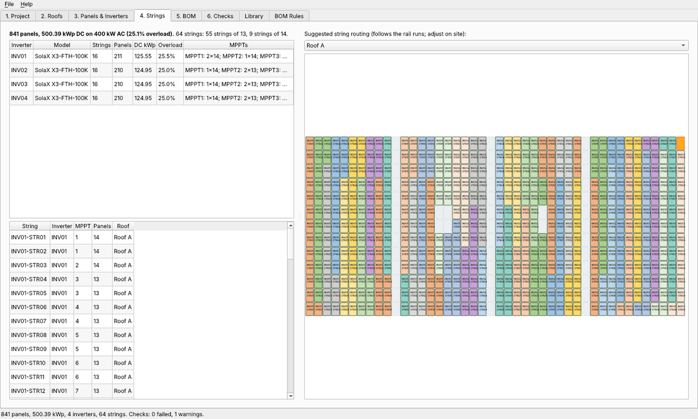
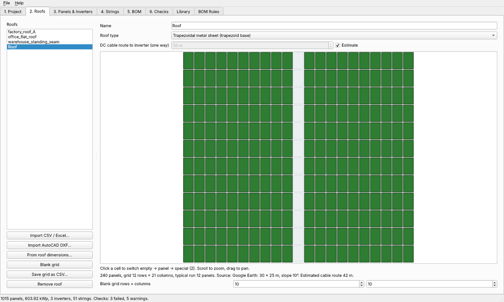
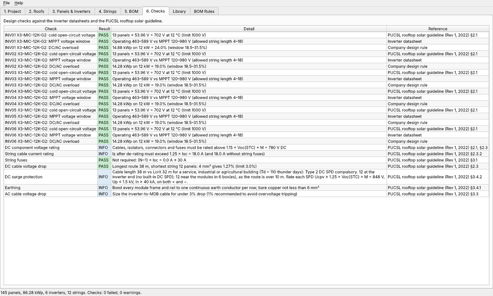
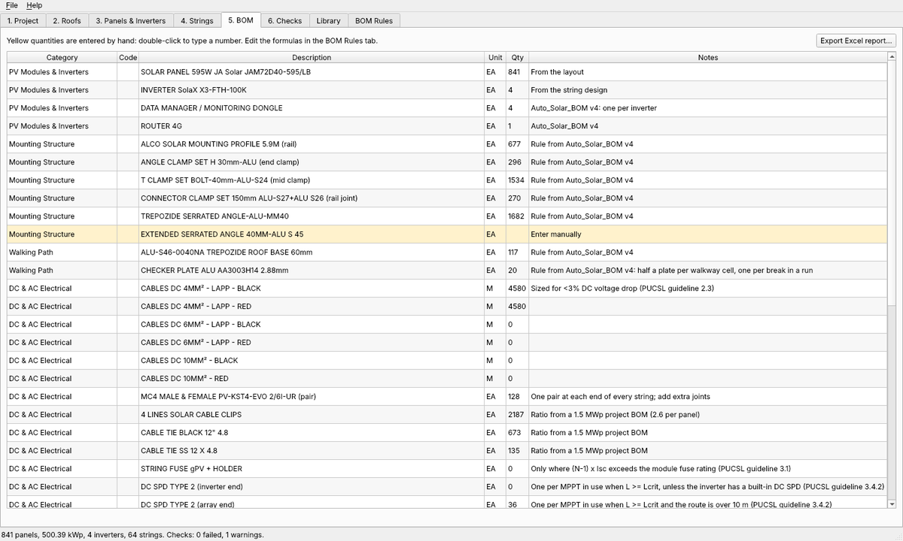

# Solar PV Designer

A free Windows desktop app for rooftop solar engineers. Give it the roof layout and the inverters you have, and it works out:

- **the bill of materials**: rails, clamps, roof bases, walkway plates, earthing, DC cable, connectors and protection, per roof type;
- **the string design**: string lengths from the panel and inverter datasheets, strings per MPPT and per inverter, DC/AC overload, and a string schedule labelled `INV01-STR01`, `INV01-STR02`…;
- **design checks** against the PUCSL *Guidelines on Rooftop Solar PV Installation for Solar Service Providers* (Rev 1, September 2022).

Everything exports to one Excel workbook: BOM, inverter summary, string schedule, checks and a colour-coded string layout for each roof.



| Roof layout | Design checks | Bill of materials |
|---|---|---|
|  |  |  |

## Install

1. Download **[SolarPVDesigner-Setup.exe](https://github.com/mithilyr/solar-pv-designer/releases/latest)** from the latest release. You don't need a GitHub account.
2. Run it. It installs for your Windows user only, so it needs no administrator rights, and it adds a Start menu shortcut. Double-clicking a `.spvd` project file opens it in the app.

The installer is not code-signed yet, so Windows SmartScreen may say "Windows protected your PC". Click **More info**, then **Run anyway**.

To try it straight away, open one of the made-up sites in [`examples/projects`](examples) with **File > Open**.

## How to use it

1. **Project**: name the site, pick the climate region and the district (for thunder days), and say whether it is a house, a commercial or industrial building, or a ground-mounted plant. The lowest temperature sets the maximum string length (cold panels give higher voltage), so choose *Hill country* for Nuwara Eliya and similar sites.
2. **Roofs**: add each roof face in one of three ways:
   - **From roof dimensions**: measure the roof in Google Earth Pro with the ruler tool, then enter its length (along the rails), width, slope and setbacks. The app fits the panels and shows the result.
   - **Import AutoCAD DXF**: in AutoCAD, `SAVEAS` the layout as DXF. Panels drawn as copies of one block, or as closed rectangles, become the grid.
   - **Import CSV / Excel**: a grid with `1` for a panel, `0` for empty space or walkway, and `2` for a special cell. Each column is one rail run.

   Click cells to fix the layout by hand. Choose the roof type for each roof: trapezoidal sheet, standing seam/Kalzip, Amano/corrugated, concrete flat or clay tile.
3. **Panels & Inverters**: pick the panel and add inverters, or press *Suggest inverters* to list models and quantities that fit the overload window. String lengths are chosen automatically and follow the rail runs where possible. You can also fix them yourself, for example `12, 13`.
4. **Strings**: review the inverter loading, the MPPT layout and the string schedule. The roof view shows a suggested routing that follows the rail runs.
5. **BOM**: yellow lines are entered by hand, so double-click the quantity to type one. Use **Export Excel report** to write the workbook.
6. **Checks**: shows each check as passed, warning or failed, with the guideline clause it comes from.

### Editing the library and rules

- **Library**: panels and inverters with their datasheet values. Add your company's models, correct a value, or use Import/Export to share one library across the office. Your edits are saved for your Windows user (in `%APPDATA%\SolarPVDesigner`) and are kept when the app is updated.
- **BOM Rules**: every quantity is a formula, such as `2 * (panels - runs)` for mid clamps. Change the formulas, add your company's item codes, or add new items. The help panel lists the names you can use, and **Check and save rules** catches mistakes before saving.

## What the checks cover

| Check | Rule |
|---|---|
| Cold open-circuit voltage | String Voc at the lowest temperature ≤ inverter max DC voltage and module max system voltage |
| MPPT window | String Vmp, hot and cold, inside the inverter MPPT range |
| MPPT current | Strings in parallel within the inverter's input and short-circuit current per MPPT |
| DC/AC overload | Each inverter inside the overload window (18.5 to 31.5% by default) and under its max PV power |
| DC ratings | 1.15 × Voc(STC) × M and 1.25 × Isc (guideline §2.1, §2.3) |
| String fuses | Needed when (N−1) × Isc exceeds the module's series fuse rating; fuse sized between 1.5 and 2.4 × Isc (§3.1) |
| DC voltage drop | Below 3% at maximum power (§2.3); the cable size is chosen to meet it |
| Surge protection | DC SPD compulsory when the DC cable length is at least Lcrit (§3.4.2): 450/Ng for commercial and industrial buildings, 115/Ng for houses, 200/Ng for ground-mounted plant. Thunder days come from the district map in Annex A (the top of each band). Ng uses 0.04 × Td^1.25 from IEC 62305-2; the guideline prints the exponent as 1.12, and 1.25 is the more cautious of the two. Inverters with a built-in Type II DC SPD need none at the inverter end; routes over 10 m need a second set near the modules |
| MPPT layout | Every MPPT gets a string before any MPPT takes two, and two strings share an MPPT only when they are the same length. Strings that run across roofs, or MPPTs fed from two roofs, are flagged (Annex B item 10) |

The tool helps with design but does not replace an engineer's review. Check every design against the site and the latest datasheets before construction.

## Built-in data

| Inverters | Source |
|---|---|
| SolaX X1-BOOST G4 (2.5 to 6 kW, single phase) | SolaX datasheet |
| SolaX X3-MIC G2 (3 to 15 kW) | SolaX datasheet |
| SolaX X3-MEGA G2 (40 to 60 kW) | SolaX datasheet |
| SolaX X3-FORTH (75 to 150 kW) | SolaX datasheet V3.1.1 |
| SMA Sunny Tripower CORE2 STP 110-60 | SMA datasheet |
| Huawei SUN2000-330KTL-H1 | Huawei datasheet (2023-05-15) |

Panels: JA Solar JAM72D40 595 W and 600 W (DeepBlue 4.0). Add more in the Library tab.

The mounting rules for trapezoidal roofs come from the original Auto_Solar_BOM calculator, and the tests check that they still give the same numbers. Rules for the other roof types are generic starting points: check them against your mounting supplier's guide.

## For developers

```bash
python -m pip install -e ".[dev]"
python -m pytest
python -m solarpv           # run the app
pyinstaller packaging/solarpv.spec --noconfirm   # freeze (Windows)
iscc packaging/installer.iss                     # installer (Inno Setup 6)
```

The code is under `src/solarpv`:

- `layout.py`: grids, CSV/Excel import, and fitting panels to roof dimensions
- `dxf_import.py`: reading layouts from AutoCAD DXF files
- `bom.py` and `formula.py`: grid measurements and the editable BOM rules
- `strings.py`: string limits, string splits and allocation to MPPTs
- `checks.py`: the guideline checks
- `project.py`: the design pipeline and saving/opening `.spvd` files
- `export_excel.py`: the Excel report
- `gui/`: the PySide6 desktop interface

GitHub Actions runs the tests on Windows and Linux for every push. On `main`, and on every `v*` tag, it also builds the Windows installer; tags publish it as a release.

## Licence

MIT. See [LICENSE](LICENSE).
